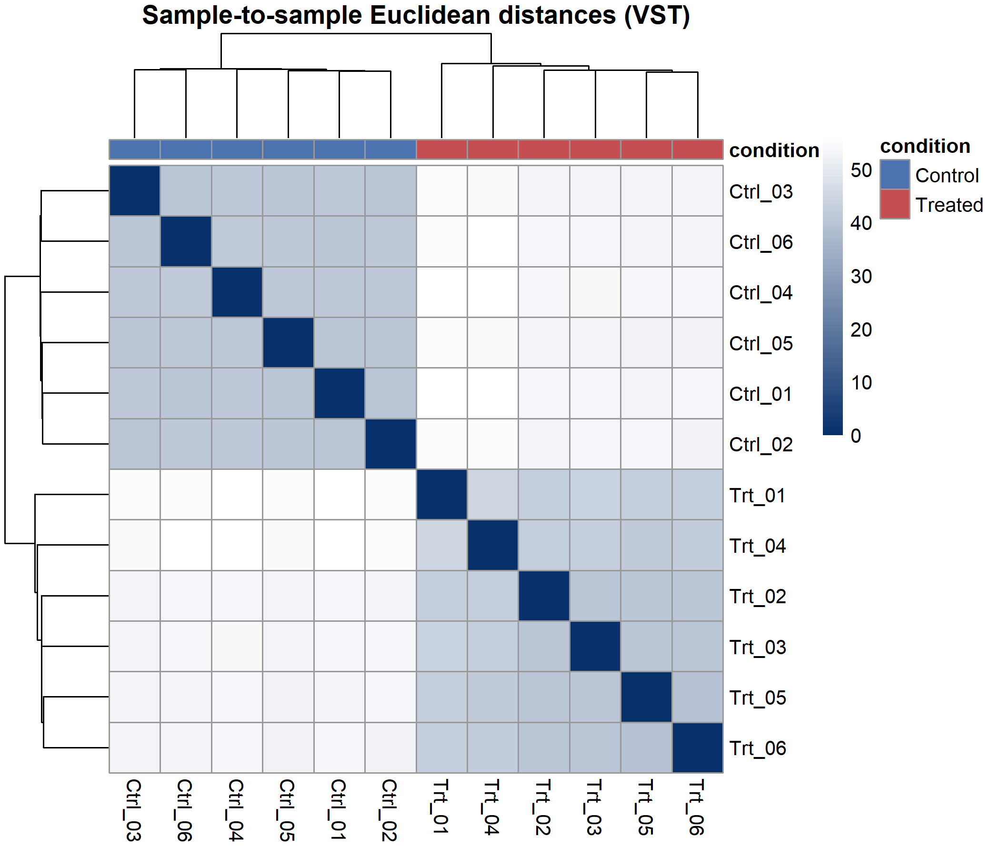
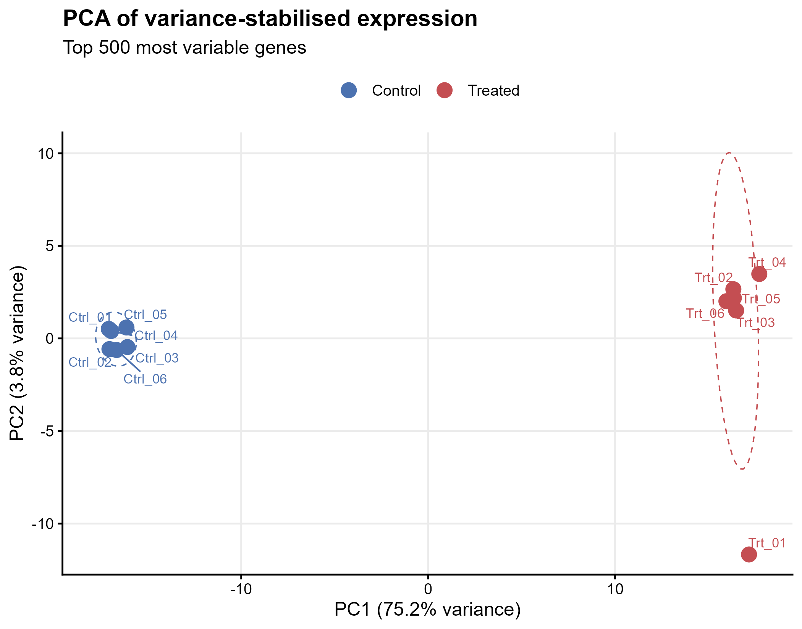
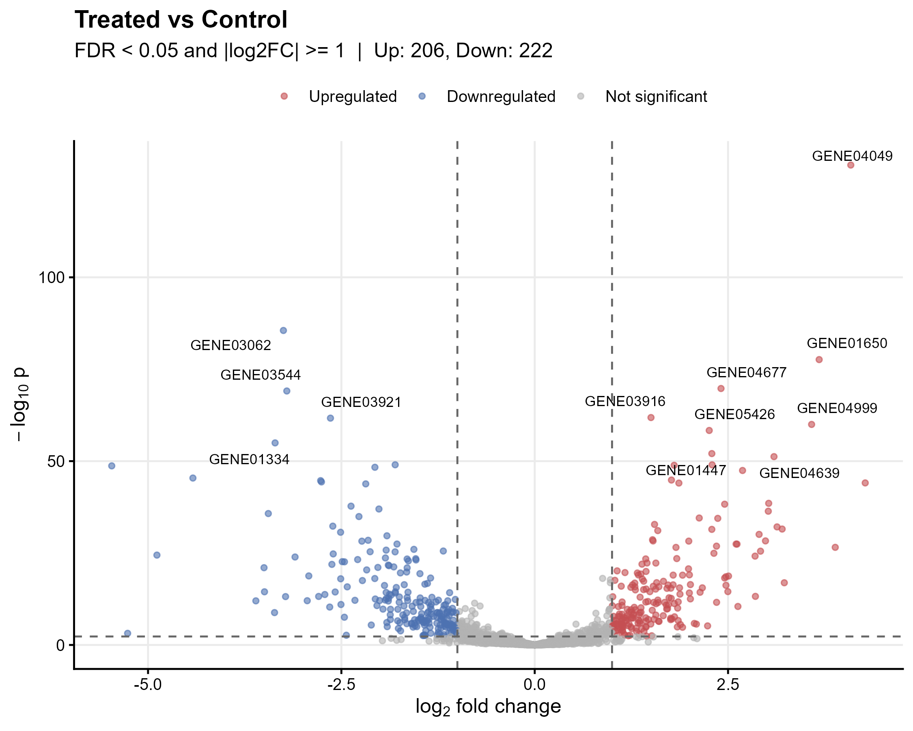
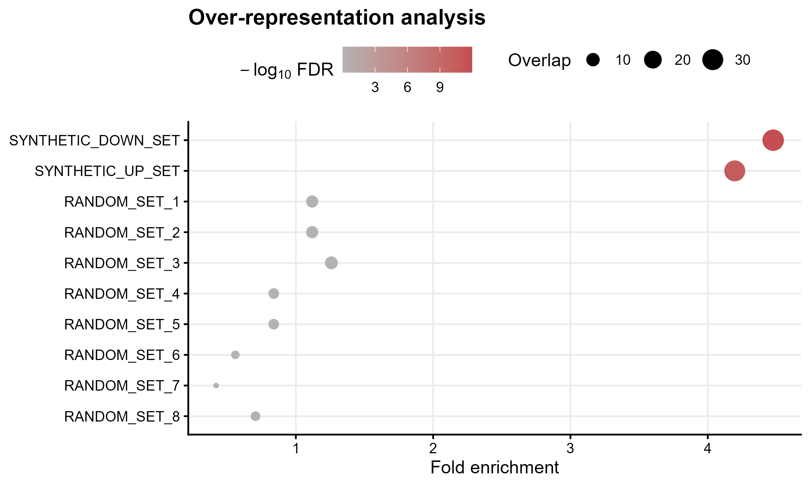

# Bulk RNA-Seq Differential Expression Pipeline

An end-to-end, reproducible R pipeline for bulk RNA-Seq differential expression (DE) and functional enrichment analysis.

## Overview
- **Statistical Core (CRAN-only):** Transparent implementation of the Negative Binomial GLM framework (`MASS`), median-of-ratios normalization, empirical Bayes dispersion shrinkage toward the mean-dispersion trend, and Variance-Stabilizing Transformation (VST) for exploratory analysis.
- **Validation:** Benchmarked against simulated count data with known ground truth (`precision = 0.89`, `recall = 0.90`, `LFC correlation = 0.99`).
- **Standard Industry Workflow:** Includes a modular Bioconductor block (`DESeq2`, `apeglm`, `AnnotationDbi`, `clusterProfiler`) ready for real-world datasets (e.g., `airway`).

## Key Outputs

### Sample-to-Sample Distances


### Sample Clustering (PCA)


### Differential Expression (Volcano Plot)


### Functional Enrichment (ORA)


## Repository Structure
- `rnaseq_pipeline.R` — Main modular pipeline script + commented Bioconductor real-data workflow.
- `results/` — Exported figures (`.png`), differential expression & enrichment tables (`.csv`), benchmark metrics, and `sessionInfo.txt`.

## Usage
Run the pipeline from the terminal or RStudio:
```bash
Rscript rnaseq_pipeline.R
